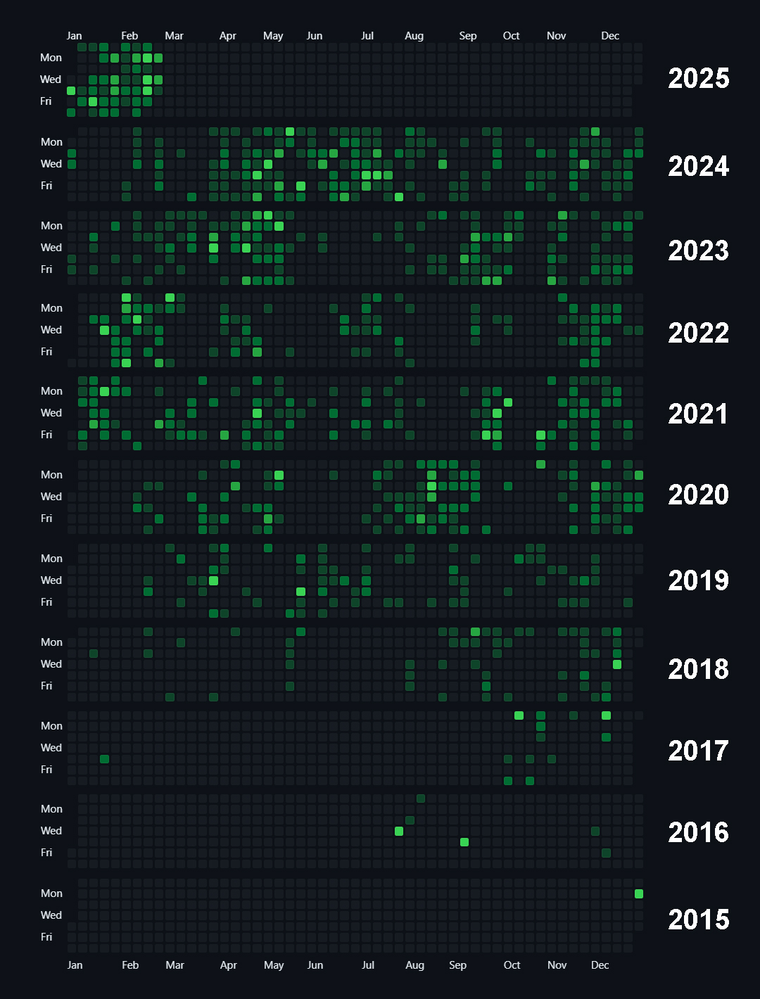
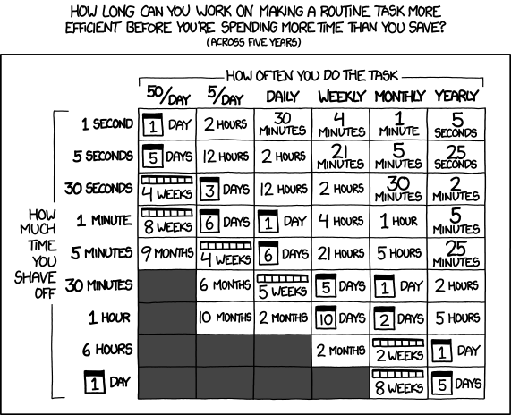
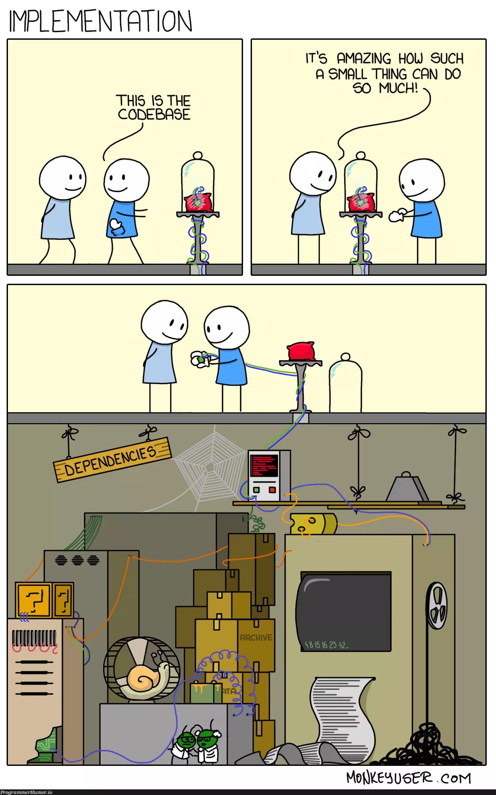
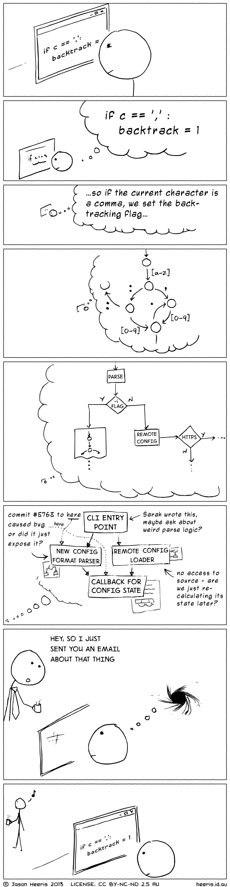
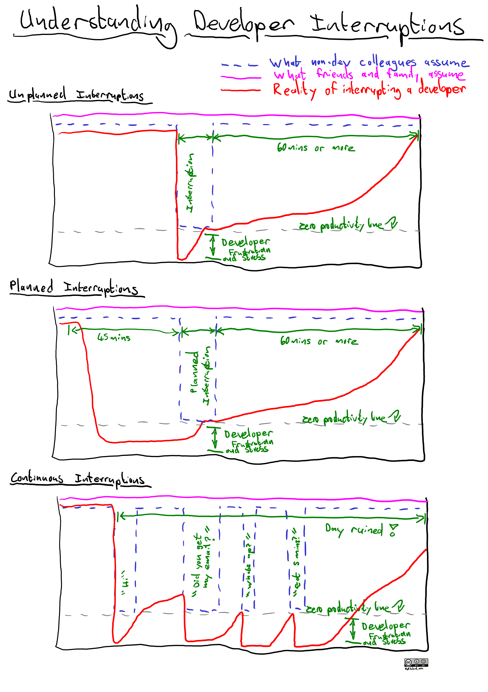

# Wisdoms

> **Most of programming is really just taking data from place A, transforming it, and putting it in place B.**

> **90% of real-world programs are database frontends, held by duct tape.**

> **The march of nines: Achieving 90%, 99%, 99.9%, or 99.99%... means stacking nines — and each new one takes as much work as all the previous ones combined.**

# Programming

### **Styles**

- [Overview](./topics/styles/overview.md)
- [Object Oriented Programming (OOP)](./topics/styles/oop.md)
- [Functional Programming (FP)](./topics/styles/fp.md)

### **Javascript**

- [Basics](./topics/javascript/basics.md)
- [ES6](./topics/javascript/es6.md)
- [Document Object Model (DOM)](./topics/javascript/dom.md)
- [Async](./topics/javascript/async.md)
- [Debugging](./topics/javascript/Debugging.md)
- [Typescript](./topics/javascript/typescript.md)

### **Frontend**

- Frameworks
    - [Svelte](./topics/svelte.md)
    - [Solidjs](./topics/solidjs.md)
    - [React](./topics/react.md)
    - [Vue](./topics/vue.md)
    - [Electron](./topics/electron.md)
    - [Elm](./topics/elm.md)
- Libraries
    - [tabulator](./topics/tabulator.md)
    - [tagify](./topics/tagify.md)
    - [pdfmake](./topics/pdfmake.md)
    - [sheetjs](./topics/sheetjs.md)
    - [Various](./topics/libraries-frontend.md)
- Other
    - [CSS](./topics/css.md)
    - [Tailwind](./topics/tailwind.md)
    - [Web Components](./topics/webComponents.md)
- Bundlers
    - [Babel](./topics/babel.md)
    - [Webpack](./topics/webpack.md)

### **Backend**

- Technologies
    - [Node](./topics/node.md)
        - [npm/npx](./topics/npm.md)
        - [Express](./topics/express.md)
            - [Code Structure](./topics/express-structure.md)
        - [Middleware](./topics/middleware.md)
        - [.env](./topics/dotenv.md)
    - [Web Sockets](./topics/websockets.md)
    - [GraphQL](./topics/graphql.md)
- Libraries
    - [cryptojs](./topics/cryptojs.md)
    - [nodemailer](./topics/nodemailer.md)
    - [puppeteer](./topics/puppeteer.md)
- Other
    - [Caching](./topics/caching.md)
    - [Logging](./topics/logging.md)

### **Database**

- Concepts
    - [Terminology](./topics/database/terminology.md)
    - [Conventions](./topics/database/conventions.md)
    - [Normalization](./topics/database/normalization.md)
- Queries
    - [Admin](./topics/database/queriesAdmin.md)
    - [Schema](./topics/database/queriesSchema.md)
    - [CRUD](./topics/database/queriesCRUD.md)
    - [Aggregate](./topics/database/queriesAggregate.md)
    - [Window](./topics/database/queriesWindow.md)
    - [Various](./topics/database/queriesVarious.md)
    - [Logic](./topics/database/queriesLogic.md)
    - [Pivot](./topics/database/queriesPivot.md)
    - [Indexes](./topics/database/queriesIndexes.md)
    - [Utilities](./topics/database/queriesUtilities.md)
- Optimization
    - [Hardware](./topics/database/optimizationHardware.md)
    - [Engine](./topics/database/optimizationEngine.md)
    - [Querying](./topics/database/optimizationQuerying.md)
    - [Indexing](./topics/database/optimizationIndexing.md)
    - [Diagnostics](./topics/database/optimizationDiagnostics.md)
- Systems
    - [MySQL](./topics/database/mysql.md)
        - [node mysql](./topics/database/node-mysql.md)
    - [SQL Server](./topics/database/sqlserver.md)
        - [node mssql](./topics/database/node-mssql.md)
    - [PostgreSQL](./topics/database/postgresql.md)
- ORMs
    - [Drizzle](./topics/database/ormDrizzle.md)

### **Web Server**

- [nginx](./topics/webserver/nginx.md)
- [SSL](./topics/webserver/ssl.md)

### **Code Optimization**

- [Premature Optimzation](./topics/optimization/premature.md)
- [Graphs](./topics/optimization/graphs.md)
- [Dependency Injection](./topics/optimization/dependencyInjection.md)
- [Naming Conventions](./topics/optimization/naming.md)
- [No nesting](./topics/optimization/nesting.md)
- [No comments](./topics/optimization/comments.md)
- [Algorithms](./topics/optimization/algorithms.md)
- [Code Golf](./topics/optimization/codeGolf.md)

### **Tooling**

- [VS Code](./topics/vscode.md)
- [Git](./topics/git.md)

### **Testing**

- [Testing](./topics/testing/testing.md)
    - [Jest](./topics/testing/jest.md)
    - [Mocha](./topics/testing/mocha.md)

# **Binary**

- [Binary](./topics/binary/binary.md)
    - [ASCII](./topics/binary/ascii.md)
    - [Bitwise](./topics/binary/bitwise.md)
- [Assembly](./topics/assembly.md)
    - [WebAssembly](./topics/wasm.md)

# **Theory**

### **Architecture**

- [MVC](./topics/mvc.md)
- [Multi-tenancy](./topics/multiTenancy.md)
- [RESTful](./topics/restful.md)
- [Microservices](./topics/microservices.md)
- [Serverless](./topics/serverless.md)
- [Message Brokers](./topics/messageBrokers.md)

### **Methodologies**

- [Agile](./topics/agile.md)

### **Other**

- [.NET](./topics/dotnet.md)

# Mobile

- [Overview](./topics/mobile.md)

### **Native**

- [Android (Kotlin, Java) - Android Studio / Google](./topics/mobileAndroid.md)
- [iOS (Swift, Objective-C) - XCode / Apple](./topics/mobileiOS.md)

### **Compiled**

- React Native (React, Javascript)
- Native Script (XML, Javascript)
- Flutter (Dart)

### **Hybrid (HTML, CSS, Javascript)**

- [Cordova](./topics/mobileCordova.md)
- [Capacitor](./topics/mobileCapacitor.md)
- [PWA](./topics/mobilePWA.md)

# Workflow

- [Environment](./topics/workflow/environment.md)
- [Development](./topics/workflow/development.md)
- [Deployment](./topics/workflow/deployment.md)

# Linux

### **System**

- [Distros](./topics/linux/distros.md)
- [Windows Subsystem for Linux (WSL)](./topics/linux/wsl.md)
- [Environment Variables](./topics/linux/environment.md)
- [Filesystem](./topics/linux/filesystem.md)

### **Administration**

- [Terminal](./topics/linux/terminal.md)
- [Processes](./topics/linux/processes.md)
- [Services](./topics/linux/services.md)
- [Users](./topics/linux/users.md)

### **Tools**

- [vim - editor](./topics/linux/vim.md)
- [tmux - terminal windows multiplexer](./topics/linux/tmux.md)
- [grep - search](./topics/linux/grep.md)
- [fzf - fuzzy finder](./topics/linux/fzf.md)
- [bash - scripting](./topics/linux/bash.md)
- [ssh - remote access](./topics/linux/ssh.md)
- [rsync - file transfer](./topics/linux/rsync.md)
- [cron - scheduling](./topics/linux/cron.md)
- [gzip - compression](./topics/linux/gzip.md)
- [ffmpeg - video & audio](./topics/linux/ffmpeg.md)

# Networking

- [Overview](./topics/networkingOverview.md)
- [OSI Model](./topics/networkingModelOSI.md)
- [TCP/IP Model](./topics/networkingModelTCPIP.md)
    - [2. Link - MAC](./topics/networkingLayer2LinkMAC.md)
    - [3. Network - IP, Subnet, Gateway, DHCP](./topics/networkingLayer3NetworkIP.md)
    - [4. Transfer - TCP, Ports ](./topics/networkingLayer4TransferTCP.md)
    - [5. Application - HTTP, DNS, DDNS](./topics/networkingLayer5ApplicationHTTP.md)
- [Tools](./topics/networkingTools.md)
- [Devices](./topics/networkingDevices.md)
- [Roles](./topics/networkingRoles.md)

# Cybersecurity

- [Best practices](./topics/cybersecurity/cybersecurity.md)
- [JSON Web Tokens (JWT)](./topics/cybersecurity/jwt.md)
- [SQL Injection](./topics/cybersecurity/sqlinjection.md)
- [Cross Site Scripting (XSS)](./topics/cybersecurity/xss.md)
- [Cross Site Request Forgery (CSRF)](./topics/cybersecurity/csrf.md)
- [Cross-origin resource sharing (CORS)](./topics/cybersecurity/cors.md)

# DevOps

### **FTP**

- [File Transfer Protocol (FTP)](./topics/ftp.md)

### **Virtualization**

- [Virtual Machine (VM)](./topics/vm.md)
- [Vagrant](./topics/vagrant.md)

### **Containerization**

- [Docker](./topics/docker.md)

### **Configuration Management**

- [Ansible](./topics/ansible.md)

# Artificial Intelligence (AI)

- [Models](./topics/ai/models.md)
- [Concepts](./topics/ai/concepts.md)
- [Prompting](./topics/ai/prompting.md)
- [GSD](./topics/ai/gsd.md)
- [ChatGPT API](./topics/ai/apiChatGPT.md)
- [Langchain](./topics/ai/langchain.md)
- [Whisper](./topics/ai/whisper.md)

# Blockchain

[Overview](./topics/blockchain.md)

# Electronics

### **General**

- [Electronics](./topics/electronics/electronics.md)
- Terminology
- Communication Protocols
- Components
- [RFID](./topics/electronics/rfid.md)

### **Embedded**

- [Raspberry Pi](./topics/electronics/raspberrypi.md)
- [Arduino](./topics/electronics/arduino.md)
- [NodeMCU](./topics/electronics/nodemcu.md)

### **Electricity**

- [Electricity](./topics/electronics/electricity.md)

# Startup

**Good product**

If you can build a product that is so good, people spontaneosly tell their friends about it, you've done 80% of the work you need to be a really successful startup.

The most successful companies you know, you've probably found out about them because a friend of your's said "You have to try this, it's great!".

One important indicator for a product like that is a product that's simple to explain and easy to understand.

If you can't explain in a few words what you do, and some people say "Oh, that's pretty interesting...", it's a mistake, and usually a sign of unclear thinking, or a need that is not big enough.

---

**Solopreneur**

You need 3 things:

1. Going **all-in** on either (outsource the rest):
    - **distribution** (sales, influencer, content).
    - **product** (coding, design).
2. **Expertise** in a **technical skill**, be it copywriting, design, coding, finance...
3. **Leverage**, in the forms of **code**, **media** or **capital**. You can't use labor.

---

### **Startup**

- [Ideas](./topics/startup/startupIdeas.md)
- [Equity](./topics/startup/startupEquity.md)
- [Motivation](./topics/startup/startupMotivation.md)
- [Focus](./topics/startup/startupFocus.md)
- [Problem-solving](./topics/startup/startupProblemSolving.md)
- [Game Plan](./topics/startup/startupGamePlan.md)

### **Product**

- [Market Fit](./topics/startup/productMarketFit.md)
- [Business Model](./topics/startup/productBusinessModel.md)
- [Design](./topics/startup/productDesign.md)
- [MVP](./topics/startup/productMVP.md)

### **Sales**

- [Pitch](./topics/startup/salesPitch.md)
- [Pricing](./topics/startup/salesPricing.md)
- [Overview](./topics/startup/salesOverview.md)
- [Enterprise](./topics/startup/salesEnterprise.md)
- [Cold Calling](./topics/startup/salesColdCalling.md)
- [Email](./topics/startup/salesEmail.md)
- [Objections](./topics/startup/salesObjections.md)
- [Linkedin](./topics/startup/salesLinkedin.md)
- [Meetings](./topics/startup/salesMeetings.md)

### Copywriting

- [Best Practices](./topics/startup/copywritingBestPractices.md)
- [Frameworks](./topics/startup/copywritingFrameworks.md)
- [Direct Response](./topics/startup/copywritingDirectResponse.md)
- [Ad Creatives](./topics/startup/copywritingAdCreatives.md)

### Marketing

- [SEO](./topics/startup/marketingSeo.md)
- [Google Analytics](./topics/startup/marketingGoogleAnalytics.md)
- [Facebook Pixel](./topics/startup/marketingFacebookPixel.md)
- [Google Tag Manager](./topics/startup/marketingGoogleTagManager.md)
- [Advertising](./topics/startup/marketingAdvertising.md)

# Random

- [Excel](./topics/excel.md)
- [Statistics](./topics/statistics.md)
- [Googling](./topics/googling.md)
- [Youtube](./topics/youtube.md)

# **APIs**

- [Google API](./topics/googleapi.md)
- [Reddit API](./topics/reddit.md)

# Commits

# Comics

[Automation](https://xkcd.com/1319/)

---

[Is It Worth the Time?](https://xkcd.com/1205/)

---

[Dependency](https://xkcd.com/2347/)

---

Dependency 2

---

[Standards](https://xkcd.com/927/)

---

[Password Strength](https://xkcd.com/936/)

---

Interruption 1

---

Interruption 2

# Innovation

### Software

| Year | Invention                                    | Inventor(s)                  |
| ---: | -------------------------------------------- | ---------------------------- |
| 1969 | UNIX (operating system)                      | Ken Thompson, Dennis Ritchie |
| 1979 | VisiCalc (spreadsheet)                       | Dan Bricklin, Bob Frankston  |
| 1983 | GNU Project (free software movement + tools) | Richard Stallman             |
| 1985 | Windows 1.0                                  | Microsoft                    |
| 1991 | Linux kernel                                 | Linus Torvalds               |
| 1993 | Mosaic (web browser)                         | Marc Andreessen, Eric Bina   |
| 1994 | Netscape Navigator                           | Netscape                     |
| 1995 | Internet Explorer                            | Microsoft                    |
| 1998 | Google Search                                | Google                       |
| 2001 | Wikipedia                                    | Wikimedia Foundation         |
| 2004 | Facebook                                     | Facebook                     |
| 2005 | YouTube                                      | YouTube                      |
| 2006 | Twitter                                      | Twitter                      |
| 2008 | Google Chrome                                | Google                       |
| 2008 | Android                                      | Google                       |
| 2010 | Instagram                                    | Instagram                    |
| 2011 | iOS (modern mobile OS maturity era)          | Apple                        |
| 2014 | Docker                                       | Solomon Hykes                |
| 2016 | Kubernetes                                   | Google                       |

### Programming

| Year | Invention                                | Inventor(s)                            |
| ---: | ---------------------------------------- | -------------------------------------- |
| 1947 | Assembly language                        | Kathleen Booth                         |
| 1952 | Compiler                                 | Grace Hopper                           |
| 1957 | FORTRAN                                  | John Backus                            |
| 1958 | LISP                                     | John McCarthy                          |
| 1959 | COBOL                                    | Grace Hopper and committee             |
| 1964 | BASIC                                    | John Kemeny, Thomas Kurtz              |
| 1969 | UNIX (programming environment influence) | Ken Thompson, Dennis Ritchie           |
| 1970 | Pascal                                   | Niklaus Wirth                          |
| 1972 | C programming language                   | Dennis Ritchie                         |
| 1972 | Smalltalk (object-oriented programming)  | Alan Kay, Adele Goldberg, others       |
| 1974 | SQL                                      | Donald D. Chamberlin, Raymond F. Boyce |
| 1983 | C++                                      | Bjarne Stroustrup                      |
| 1987 | Perl                                     | Larry Wall                             |
| 1991 | Python                                   | Guido van Rossum                       |
| 1995 | Java                                     | James Gosling                          |
| 1995 | JavaScript                               | Brendan Eich                           |
| 1995 | PHP                                      | Rasmus Lerdorf                         |
| 2000 | C#                                       | Anders Hejlsberg                       |
| 2009 | Go                                       | Google                                 |
| 2014 | Swift                                    | Apple                                  |
| 2014 | Rust                                     | Graydon Hoare                          |

### Networking

| Year | Invention                             | Inventor(s)                        |
| ---: | ------------------------------------- | ---------------------------------- |
| 1965 | Packet switching (concept)            | Paul Baran, Donald Davies          |
| 1969 | ARPANET                               | Larry Roberts and team             |
| 1971 | Network email                         | Ray Tomlinson                      |
| 1973 | Ethernet                              | Robert Metcalfe                    |
| 1974 | TCP/IP                                | Vint Cerf, Bob Kahn                |
| 1978 | TCP/IP split into TCP and IP          | Vint Cerf, Jon Postel, Danny Cohen |
| 1983 | Domain Name System (DNS)              | Paul Mockapetris                   |
| 1988 | BGP (Border Gateway Protocol)         | Yakov Rekhter, Kirk Lougheed       |
| 1989 | World Wide Web (infrastructure layer) | Tim Berners-Lee                    |
| 1991 | HTTP                                  | Tim Berners-Lee                    |
| 1995 | SSL                                   | Netscape                           |
| 1999 | Wi-Fi (802.11b)                       | IEEE                               |
| 2010 | 4G LTE                                | telecom industry consortiums       |
| 2015 | HTTP/2                                | IETF                               |
| 2018 | QUIC                                  | Google                             |
| 2019 | 5G networks                           | telecom industry consortiums       |

### Hardware

| Year | Invention                                       | Inventor(s)                                     |
| ---: | ----------------------------------------------- | ----------------------------------------------- |
| 1801 | Jacquard punch-card control                     | Joseph Marie Jacquard                           |
| 1822 | Difference Engine                               | Charles Babbage                                 |
| 1837 | Analytical Engine                               | Charles Babbage                                 |
| 1884 | Tabulating Machine                              | Herman Hollerith                                |
| 1939 | Atanasoff–Berry Computer (ABC)                  | John Atanasoff, Clifford Berry                  |
| 1941 | Z3 (programmable digital computer)              | Konrad Zuse                                     |
| 1943 | Colossus                                        | Tommy Flowers                                   |
| 1945 | ENIAC                                           | J. Presper Eckert, John Mauchly                 |
| 1947 | Transistor                                      | John Bardeen, Walter Brattain, William Shockley |
| 1948 | Manchester Baby (first stored-program computer) | Frederic C. Williams, Tom Kilburn               |
| 1951 | UNIVAC I (first commercial computer)            | Eckert–Mauchly team                             |
| 1956 | Hard Disk Drive (IBM 305 RAMAC)                 | IBM team                                        |
| 1958 | Integrated Circuit                              | Jack Kilby, Robert Noyce                        |
| 1963 | Computer mouse (prototype)                      | Douglas Engelbart                               |
| 1965 | DRAM (dynamic random-access memory)             | Robert H. Dennard                               |
| 1969 | CCD (charge-coupled device)                     | Willard Boyle, George E. Smith                  |
| 1970 | EPROM (erasable programmable ROM)               | Dov Frohman                                     |
| 1971 | Microprocessor (Intel 4004)                     | Ted Hoff, Federico Faggin, others               |
| 1974 | 8080 microprocessor                             | Intel team                                      |
| 1976 | Cray-1 supercomputer                            | Seymour Cray                                    |
| 1977 | Apple II                                        | Apple                                           |
| 1977 | TRS-80                                          | Tandy Corporation                               |
| 1981 | IBM PC (mass-market personal computer)          | IBM team                                        |
| 1982 | Commodore 64                                    | Commodore International                         |
| 1984 | Macintosh                                       | Apple                                           |
| 1985 | ARM architecture                                | Sophie Wilson, Steve Furber                     |
| 1989 | Sound Blaster (PC sound card standard)          | Creative Technology                             |
| 1991 | Lithium-ion battery (commercialization)         | Sony team                                       |
| 1993 | Pentium processor                               | Intel                                           |
| 1996 | USB (Universal Serial Bus)                      | Intel and partners                              |
| 1998 | iMac                                            | Apple                                           |
| 1999 | GeForce 256 (first GPU)                         | NVIDIA                                          |
| 2000 | USB flash drive                                 | Dov Moran and others                            |
| 2001 | iPod                                            | Apple                                           |
| 2006 | Solid-state drive (modern SSD era)              | Samsung and others                              |
| 2007 | iPhone                                          | Apple                                           |
| 2010 | iPad                                            | Apple                                           |
| 2016 | Tensor Processing Unit (TPU)                    | Google                                          |
|      |

### Theory

| Year      | Invention                                                         | Inventor(s)                                       |
| --------- | ----------------------------------------------------------------- | ------------------------------------------------- |
| 1843      | First published computer algorithm                                | Ada Lovelace                                      |
| 1854      | Boolean Algebra                                                   | George Boole                                      |
| 1931      | Incompleteness Theorems                                           | Kurt Gödel                                        |
| 1936      | Turing Machine                                                    | Alan Turing                                       |
| 1936      | Lambda Calculus                                                   | Alonzo Church                                     |
| 1945      | Stored-program architecture (von Neumann architecture)            | John von Neumann                                  |
| 1948      | Information Theory                                                | Claude Shannon                                    |
| 1956      | Artificial Intelligence (field formalization, Dartmouth workshop) | John McCarthy, Marvin Minsky, others              |
| 1965      | Moore’s Law                                                       | Gordon Moore                                      |
| 1967      | Dynamic Programming (formalization)                               | Richard Bellman                                   |
| 1970      | Relational Database Model                                         | Edgar F. Codd                                     |
| 1971      | NP-Completeness (Cook–Levin theorem)                              | Stephen Cook, Leonid Levin                        |
| 1976      | Public-key cryptography                                           | Whitfield Diffie, Martin Hellman                  |
| 1977      | RSA cryptosystem                                                  | Ron Rivest, Adi Shamir, Leonard Adleman           |
| 1985      | Backpropagation (modern neural network training)                  | David Rumelhart, Geoffrey Hinton, Ronald Williams |
| 1995      | Support Vector Machines                                           | Vladimir Vapnik, Corinna Cortes                   |
| 2001      | Randomized Algorithms (modern framework)                          | Rajeev Motwani and others                         |
| 2006–2012 | Deep learning breakthrough era                                    | Geoffrey Hinton, Yann LeCun, Yoshua Bengio        |
| 2012      | AlexNet (deep CNN breakthrough)                                   | Alex Krizhevsky, Ilya Sutskever, Geoffrey Hinton  |
| 2014      | GANs (Generative Adversarial Networks)                            | Ian Goodfellow                                    |
| 2017      | Transformer architecture                                          | Google research team                              |
